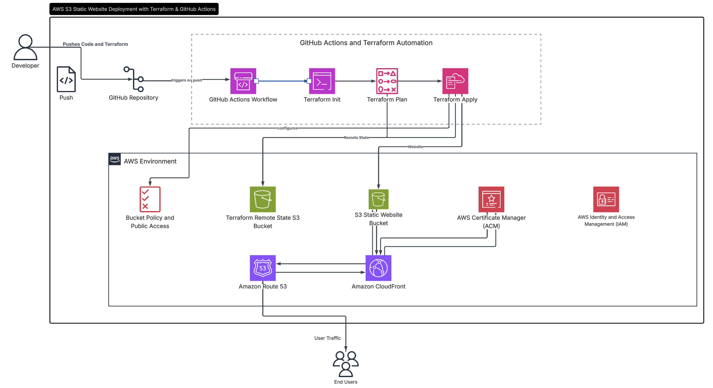
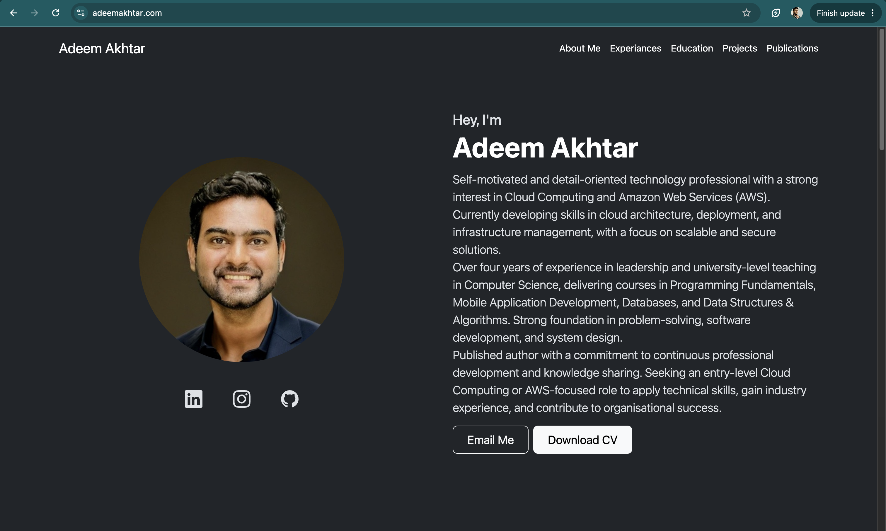
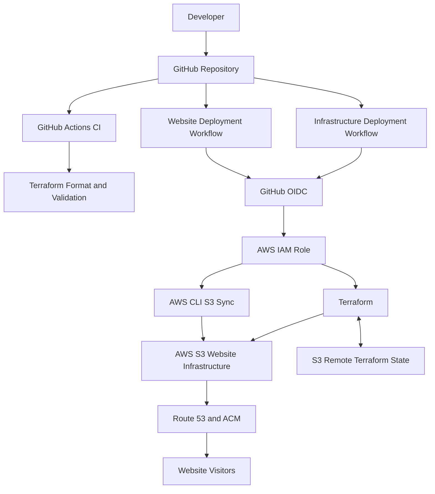
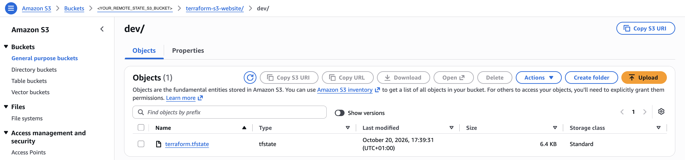
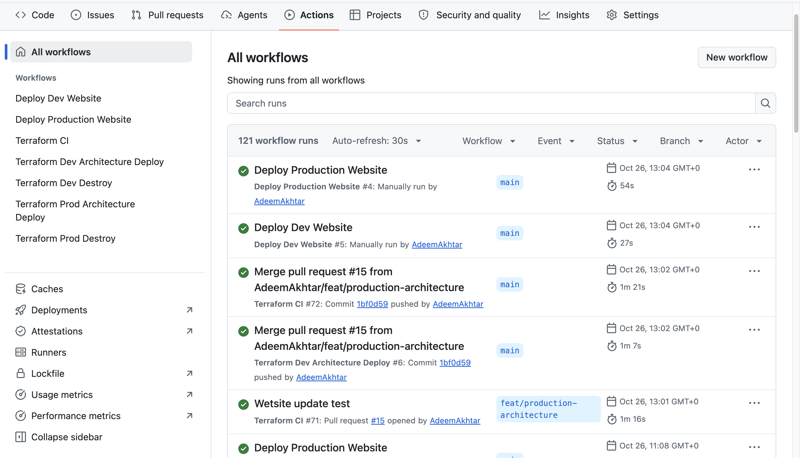
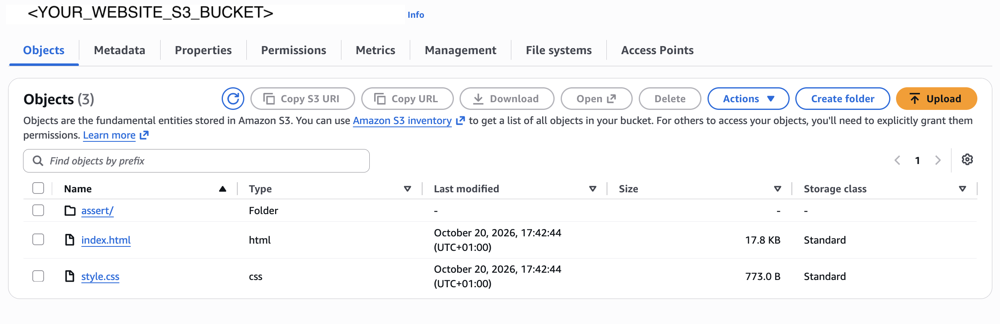

# Production-Ready Automated AWS Static Website Deployment with Terraform and GitHub Actions

An Infrastructure as Code (IaC) project demonstrating how to provision AWS infrastructure, host a static website on Amazon S3, and automate deployments using Terraform and GitHub Actions.

The project focuses on repeatable infrastructure management, secure CI/CD authentication, remote Terraform state, and separating infrastructure changes from routine website updates.

**Live website:** [View the deployed website https://www.adeemakhtar.com](https://adeemakhtar.com/)



## Project Overview

Managing cloud infrastructure manually can lead to inconsistent configurations, difficult deployments, and unnecessary operational overhead.

This project uses Terraform to define AWS infrastructure as code and GitHub Actions to automate validation and deployment tasks. Website content is maintained in a dedicated directory and can be synchronised to an existing S3 bucket without running Terraform for every content change.

The project demonstrates practical skills in AWS, Terraform, Bash, Git, CI/CD automation, IAM and cloud troubleshooting.

## Objectives

- Provision and manage AWS infrastructure using Terraform.
- Host a static website on Amazon S3.
- Store Terraform state remotely in S3.
- Use S3-native state locking where configured.
- Automate Terraform validation and infrastructure deployment with GitHub Actions.
- Authenticate GitHub Actions to AWS using OpenID Connect (OIDC).
- Separate infrastructure provisioning from website content deployment.
- Improve deployment repeatability and reduce unnecessary infrastructure changes.

## Architecture



The diagram illustrates the intended separation of responsibilities. The exact workflow triggers and steps should be checked against the current YAML files.

## Technology Stack

| Technology | Purpose |
|---|---|
| Terraform | Infrastructure as Code and resource lifecycle management |
| GitHub Actions | CI/CD automation |
| GitHub OIDC | Federated authentication to AWS |
| Bash | Deployment scripting and automation |
| Git and GitHub | Version control and collaboration |
| Amazon S3 | Stores static website files and maintains remote Terraform state. |
| IAM | Manages access permissions and securely authorises GitHub Actions to deploy AWS infrastructure. |
| Amazon CloudFront | Distributes website content globally through a CDN with HTTPS support. |
| Amazon Route 53 | Manages DNS records to route the custom domain to the CloudFront distribution. |
| AWS Certificate Manager (ACM) | Provisions and manages SSL/TLS certificates to enable secure HTTPS connections. |

## Repository Structure


```text
prod-terraform-s3-website/
├── .github/
│   └── workflows/
│       ├── terraform-ci.yml
│       ├── deploy-dev-website.yml
│       ├── deploy-prod-website.yml
│       ├── terraform-dev-destroy.yml
│       ├── terraform-prod-deploy.yml
│       ├── terraform-prod-destroy.yml
│       └── terraform-dev-deploy.yml
├── scripts/
│   ├── deploy.sh
│   └── destory.sh
├── terraform/
│   └── module/static-site
│       ├── main.tf
│       ├── variables.tf
│       └── outputs.tf
│   └── dev/
│       ├── main.tf
│       ├── providers.tf
│       ├── variables.tf
│       └── outputs.tf
│   └── prod/
│       ├── main.tf
│       ├── providers.tf
│       ├── variables.tf
│       ├── dns.tf
│       └── outputs.tf
├── website/
│   ├── index.html
│   ├── style.css
│   └── assets/
├── .gitignore
└── README.md
```

*Note: Confirm filenames and directories against the latest repository before publishing this tree.*

## How It Works

### 1. Infrastructure as Code

Terraform defines the AWS resources required to host the website. Infrastructure changes can be reviewed through a Terraform plan before being applied.

This makes the configuration version-controlled and repeatable instead of relying exclusively on manual console operations.

### 2. Remote State Management

Terraform state is stored in a dedicated S3 backend.

- **State bucket:** `<REMOTE_STATE_S3_BUCKET>`
- **Region:** `us-east-1`
- **State key:** `<REMOTE_STATE_S3_BUCKET>/dev/terraform.tfstate`
- **Locking:** S3-native lock file where enabled

The state bucket is separate from the website bucket. This separation is important because Terraform needs its state backend to remain available when managing the application infrastructure.

### 3. GitHub Actions CI/CD

The project uses separate workflows for infrastructure tasks and website delivery.

**Infrastructure workflow**

The infrastructure workflow can initialise Terraform, validate the configuration, create a plan and apply infrastructure changes.

**Website deployment workflow**

The website workflow synchronises files from the `website/` directory to the existing S3 bucket using the AWS CLI.

```bash
aws s3 sync website/ s3://YOUR_BUCKET_NAME/ --delete
```

This approach allows routine website updates without running Terraform or changing the infrastructure.

The `--delete` option removes destination objects that are absent from the local source directory. Use it only when that mirroring behaviour is intended.

### 4. Secure Authentication with GitHub OIDC

GitHub Actions can assume an AWS IAM role through OpenID Connect federation.

This allows the workflow to obtain temporary AWS credentials without storing long-lived AWS access keys in GitHub repository secrets.

The security of this arrangement depends on a correctly restricted IAM trust policy and appropriate permissions for the relevant workflow.

### 5. Static Website Hosting

The website's HTML, CSS, JavaScript and image assets are maintained in the `website/` directory and uploaded to S3.

The published deployment currently documents a direct S3 website endpoint. This endpoint uses HTTP. Do not treat the project as HTTPS-enabled or CloudFront-fronted unless those components are verified in the active deployment.

## Deployment

### Prerequisites

- An AWS account.
- Terraform installed for local infrastructure operations.
- AWS CLI installed.
- Git installed.
- An S3 backend configured for Terraform state.
- GitHub OIDC configured with an AWS IAM role.
- The required GitHub repository secret containing the role ARN, if referenced by the workflow.

### Validate Terraform locally

```bash
terraform -chdir=terraform/dev fmt -check
terraform -chdir=terraform/dev init
terraform -chdir=terraform/dev validate
terraform -chdir=terraform/dev plan -var="environment=dev"
```

Review the plan before applying changes. Do not run infrastructure commands concurrently against the same state.

### Update the website

1. Update files inside `website/`.
2. Commit and push the changes to the configured branch.
3. Allow the website deployment workflow to run.
4. Check the GitHub Actions result.
5. Verify the website in a browser.

The website-only workflow should use AWS credentials and the AWS CLI. It should not need Terraform if the bucket already exists.

## Security Considerations

- Use OIDC rather than long-lived AWS credentials for GitHub Actions.
- Apply least-privilege IAM permissions.
- Keep the Terraform state bucket private.
- Protect state and lock-file objects from unauthorised modification.
- Never commit credentials, secrets, or sensitive Terraform variable files.
- Review infrastructure plans before applying changes.
- Be cautious with `terraform destroy` and S3 synchronisation using `--delete`.
- Public S3 website hosting exposes website objects to the public; never upload confidential data.
- S3 website endpoints do not provide HTTPS.

CloudFront with Origin Access Control (OAC), a suitable ACM certificate, and custom-domain DNS can be considered for a more secure HTTPS delivery architecture if not already implemented.

## Challenges and Lessons Learned

During development, I worked through practical issues involving:

- Terraform remote state and S3 lock acquisition.
- AWS IAM permissions and S3 bucket policy restrictions.
- Non-interactive Terraform execution in GitHub Actions.
- Workflow paths and Bash script execution.
- Separating infrastructure deployment from website file updates.

These challenges reinforced the importance of understanding backend state, IAM permissions, workflow execution context and the difference between infrastructure lifecycle management and application delivery.

## Potential improvements include:

- CloudFront
```code
    {
	"Version": "2012-10-17",
	"Statement": [
		{
			"Sid": "CloudFrontDistributionReadAndManagement",
			"Effect": "Allow",
			"Action": [
				"cloudfront:GetDistribution",
				"cloudfront:GetDistributionConfig",
				"cloudfront:UpdateDistribution",
				"cloudfront:DeleteDistribution",
				"cloudfront:ListTagsForResource",
				"cloudfront:TagResource",
				"cloudfront:UntagResource",
				"cloudfront:CreateInvalidation",
				"cloudfront:GetInvalidation"
			],
			"Resource": [
				"arn:aws:cloudfront::<ACCOUNT-ID>:distribution/DESTRIBUTION-ID",
				"arn:aws:cloudfront::<ACCOUNT-ID>:distribution/DESTRIBUTION-ID"
			]
		},
		{
			"Sid": "CloudFrontDistributionDiscoveryAndCreation",
			"Effect": "Allow",
			"Action": [
				"cloudfront:ListDistributions",
				"cloudfront:CreateDistribution",
				"cloudfront:CreateDistributionWithTags"
			],
			"Resource": "*"
		},
		{
			"Sid": "CloudFrontOriginAccessControlManagement",
			"Effect": "Allow",
			"Action": [
				"cloudfront:CreateOriginAccessControl",
				"cloudfront:GetOriginAccessControl",
				"cloudfront:UpdateOriginAccessControl",
				"cloudfront:DeleteOriginAccessControl",
				"cloudfront:ListOriginAccessControls",
				"cloudfront:ListTagsForResource",
				"cloudfront:TagResource",
				"cloudfront:UntagResource"
			],
			"Resource": "*"
		}
	]
}
```

- Route 53 and ACM
```code
    {
	"Version": "2012-10-17",
	"Statement": [
		{
			"Sid": "Route53HostedZoneAndRecords",
			"Effect": "Allow",
			"Action": [
				"route53:GetHostedZone",
				"route53:ListResourceRecordSets",
				"route53:ChangeResourceRecordSets",
				"route53:ListTagsForResource"
			],
			"Resource": "arn:aws:route53:::hostedzone/<HOSTED-ZONE-ID>"
		},
		{
			"Sid": "ACMCertificateRead",
			"Effect": "Allow",
			"Action": [
				"acm:DescribeCertificate",
				"acm:ListTagsForCertificate"
			],
			"Resource": "arn:aws:acm:us-east-1:<ACCOUNT-UD>:certificate/*"
		},
		{
			"Sid": "GitHubActionsIdentityCheck",
			"Effect": "Allow",
			"Action": [
				"sts:GetCallerIdentity"
			],
			"Resource": "*"
		}
	]
}
```

- Remote-state-S3
```code
    {
	"Version": "2012-10-17",
	"Statement": [
		{
			"Sid": "TerraformRemoteStateBucket",
			"Effect": "Allow",
			"Action": [
				"s3:ListBucket"
			],
			"Resource": "<REMOTE_STATE_S3_BUCKET_ARN>",
			"Condition": {
				"StringLike": {
					"s3:prefix": [
						"<REMOTE_STATE_S3_BUCKET>/dev/terraform.tfstate",
						"<REMOTE_STATE_S3_BUCKET>/dev/terraform.tfstate.tflock",
						"<REMOTE_STATE_S3_BUCKET>/prod/terraform.tfstate",
						"<REMOTE_STATE_S3_BUCKET>/prod/terraform.tfstate.tflock"
					]
				}
			}
		},
		{
			"Sid": "TerraformRemoteStateObjects",
			"Effect": "Allow",
			"Action": [
				"s3:GetObject",
				"s3:PutObject",
				"s3:DeleteObject"
			],
			"Resource": [
				"arn:aws:s3:::<REMOTE_STATE_S3_BUCKET>/prod-terraform-s3-website/dev/terraform.tfstate",
				"arn:aws:s3:::<REMOTE_STATE_S3_BUCKET>/prod-terraform-s3-website/dev/terraform.tfstate.tflock",
				"arn:aws:s3:::<REMOTE_STATE_S3_BUCKET>/prod-terraform.tfstate",
				"arn:aws:s3:::<REMOTE_STATE_S3_BUCKET>/prod-terraform-s3-website/prod/terraform.tfstate",
				"arn:aws:s3:::<REMOTE_STATE_S3_BUCKET>/prod-terraform-s3-website/prod/terraform.tfstate.tflock"
			]
		}
	]
}
```

- Website-S3
```code
    {
	"Version": "2012-10-17",
	"Statement": [
		{
			"Sid": "WebsiteBucketManagement",
			"Effect": "Allow",
			"Action": [
				"s3:CreateBucket",
				"s3:GetBucketObjectLockConfiguration",
				"s3:GetReplicationConfiguration",
				"s3:GetBucketLogging",
				"s3:GetAccelerateConfiguration",
				"s3:GetBucketRequestPayment",
				"s3:DeleteBucket",
				"s3:ListBucket",
				"s3:GetBucketLocation",
				"s3:GetBucketAcl",
				"s3:GetBucketPolicy",
				"s3:PutBucketPolicy",
				"s3:DeleteBucketPolicy",
				"s3:GetBucketPublicAccessBlock",
				"s3:PutBucketPublicAccessBlock",
				"s3:DeletePublicAccessBlock",
				"s3:GetBucketOwnershipControls",
				"s3:PutBucketOwnershipControls",
				"s3:DeleteBucketOwnershipControls",
				"s3:GetEncryptionConfiguration",
				"s3:PutEncryptionConfiguration",
				"s3:GetBucketVersioning",
				"s3:PutBucketVersioning",
				"s3:GetBucketTagging",
				"s3:PutBucketTagging",
				"s3:DeleteBucketTagging",
				"s3:GetBucketWebsite",
				"s3:PutBucketWebsite",
				"s3:DeleteBucketWebsite",
				"s3:GetBucketCors",
				"s3:PutBucketCORS",
				"s3:DeleteBucketCORS",
				"s3:GetLifecycleConfiguration",
				"s3:PutLifecycleConfiguration",
				"s3:ListTagsForResource",
				"s3:TagResource",
				"s3:UntagResource"
			],
			"Resource": [
				"arn:aws:s3:::<YOUR-WEBSITE_S3_BUCKET>-dev",
				"arn:aws:s3:::<YOUR-WEBSITE_S3_BUCKET>-prod"
			]
		},
		{
			"Sid": "WebsiteObjectDeployment",
			"Effect": "Allow",
			"Action": [
				"s3:GetObject",
				"s3:PutObject",
				"s3:DeleteObject"
			],
			"Resource": [
				"arn:aws:s3:::<YOUR-WEBSITE_S3_BUCKET>-dev/*",
				"arn:aws:s3:::<YOUR-WEBSITE_S3_BUCKET>-prod/*"
			]
		}
	]
}
```

## What This Project Demonstrates

- Infrastructure as Code using Terraform.
- AWS S3 configuration and static website hosting.
- Remote state management and locking.
- GitHub Actions CI/CD workflow design.
- Federated AWS authentication using OIDC.
- Bash scripting and AWS CLI automation.
- Troubleshooting cloud infrastructure and deployment failures.
- Separation of infrastructure changes from routine website updates.

## Author

**Adeem Akhtar**

Cloud engineering portfolio project focused on AWS, Terraform, Infrastructure as Code and CI/CD automation.

- GitHub: [AdeemAkhtar](https://github.com/AdeemAkhtar)
- Linkedin: [AdeemAkhtar](https://www.linkedin.com/in/adeemakhtar/)
